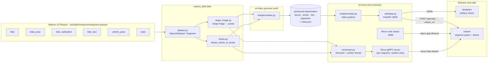
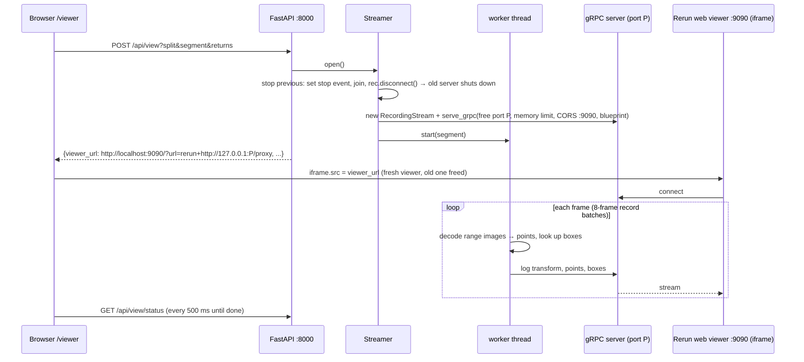

# Analytics & viewer architecture

How the Waymo Parquet files flow into the analytics page and the 3D viewer: modules, data contracts,
runtime behaviour, performance and how to extend it. The `waymo_lidar.data` layer
described here is shared with the detector, which is documented in [detector/](detector/README.md).
For the dataset itself see [dataset.md](dataset.md).

---

## Quick start

```bash
uv sync                              # Python 3.11 env from pyproject.toml / uv.lock
./download.sh training 2             # data -> ~/dev/data/waymo_v2 (see dataset.md)
uv run wl index ~/dev/data/waymo_v2  # build the analytics cache (incremental)
uv run wl serve ~/dev/data/waymo_v2  # indexes anything new, then serves:
                                     #   http://localhost:8000/analytics
                                     #   http://localhost:8000/viewer
uv run pytest                        # geometry tests (need the data)
```

| Command | Options |
|---|---|
| `wl index <root>` | `--cache DIR`, `--stride N` (default 10), `--workers N` (default: half the CPUs), `--force` |
| `wl serve <root>` | `--cache DIR`, `--port` (8000), `--viewer-port` (9090), `--memory-limit` (`2GiB`), `--no-index` |

`<root>` is the folder holding `training/` and `validation/`. It is the only required input.

---

## The big picture

There are two independent paths from the Parquet files to the browser:

- **Analytics** is precomputed. `wl index` reduces every segment once to small tables. The web
  server only aggregates those tables, so charts load in milliseconds.
- **Viewer** is live. Nothing is precomputed. When you open a segment, a background thread decodes it
  frame by frame and streams the points into Rerun.



---

## Repository layout

```
waymo_lidar/
  download.sh                 staged LiDAR-only download (see dataset.md)
  pyproject.toml, uv.lock     Python 3.11; numpy, pyarrow, polars, rerun-sdk==0.41.0, fastapi, uvicorn
  docs/                       dataset.md, analytics-viewer-architecture.md
  src/waymo_lidar/
    cli.py                    `wl index`, `wl serve`
    data/                     ── shared with the detector (det/) ──
      types.py                enums: Laser, BoxType, colours, range image channel indices
      dataset.py              WaymoDataset, Segment, LaserCalibration, FrameRangeImages, list_column()
      range_image.py          PointCloud, range_image_to_points(), frame_to_points()
      boxes.py                Boxes, box_corners(), points_in_boxes()
    analytics/
      index.py                per-segment reduction → cache tables (parallel, incremental)
      stats.py                Stats: cache → chart-ready JSON per page section
    viz/
      stream.py               Streamer: segment → Rerun recording, over gRPC
    web/
      app.py                  FastAPI routes
      static/                 analytics.html, viewer.html, style.css (no build step)
  tests/test_geometry.py      decode correctness against the dataset's own point counts
```

**Dependency direction:** `data` ← `analytics`, `viz` ← `web` ← `cli`. `data` imports nothing from the
rest of the package, which is what lets the detector reuse it.

---

## Layer 1 — `waymo_lidar.data`

### Reading (`dataset.py`)

```python
ds  = WaymoDataset("~/dev/data/waymo_v2")
seg = ds.segment("training", ds.segments("training")[0])

seg.calibration          # {laser_id: LaserCalibration(extrinsic 4x4, inclinations, min, max)}  (cached)
seg.timestamps           # (F,) int64 µs, sorted
seg.vehicle_poses        # (F, 4, 4) world_from_vehicle, aligned with timestamps
seg.pose_at(ts)          # one pose
seg.boxes_table()        # pyarrow Table of lidar_box
seg.scene()              # {"time_of_day", "location", "weather"} from stats
for fr in seg.iter_range_images(returns=(1, 2), lasers=None, timestamps=None):
    fr.timestamp, fr.images[(laser, ret)], fr.top_pose   # (H,W,4) float32, (H,W,6) or None
```

How it works:

- **Segment discovery** lists `<split>/lidar_box/*.parquet` (or `lidar/` if that's missing). A split is
  any of `training`, `validation` or `testing` that exists under the root.
- **`iter_range_images`** streams the `lidar` file in **record batches of 8 frames** (a row group holds
  about 50), skipping row groups that hold none of the requested timestamps. This keeps memory near
  2 GiB (whole row groups peaked at ~8 GiB: the range images are ~10× larger decoded) and gets the
  first frame out quickly. Rows are sorted by timestamp with 5 LiDARs per frame. A frame is emitted
  when the timestamp changes, so a frame split across two batches or row groups is still handled. The
  top LiDAR's pixel poses (`lidar_pose`) are streamed the same way, keeping only the requested frames.
- **List columns** are converted to NumPy without per-row Python objects. `list_column()` returns the
  flat values plus an offsets array, and each row is a slice of that buffer, so nothing is copied.
  Fixed-size lists (shapes, 4×4 transforms) are handled too.
- **Top-LiDAR pixel poses** (`lidar_pose`) are loaded once per segment and looked up by timestamp.

### Geometry (`range_image.py`, `boxes.py`)

All decoded points and boxes are in the **vehicle frame at the frame timestamp**: x forward, y left,
z up, origin on the ground and most likely below the rear axle. See
[dataset.md → Coordinate frames](dataset.md#coordinate-frames) for the definition and the evidence.

```python
pcs = frame_to_points(fr, seg.calibration, seg.pose_at(fr.timestamp))
pcs[(Laser.TOP, 1)]      # PointCloud: xyz (N,3) f32 vehicle frame, intensity, elongation, nlz, range
b = Boxes.from_table(seg.boxes_table()).at(fr.timestamp)
points_in_boxes(pcs[(1, 1)].xyz, b.center, b.size, b.heading)   # (N_boxes,) counts
```

`range_image_to_points` does the following, matching the official `waymo_open_dataset` utils:

1. Keep pixels with range > 0.
2. Compute each pixel's beam inclination from its row (reversed, so row 0 is the top beam) and its
   azimuth from its column (with yaw correction from the extrinsic).
3. Convert to Cartesian points in the sensor frame.
4. Apply the extrinsic to get vehicle-frame points.
5. **Top LiDAR only:** apply the pixel pose to get world points, then the inverse frame pose to get
   vehicle-frame points at the frame timestamp. This is the rolling-shutter correction.

The pose math is done in float64; the output is float32.

**Correctness is pinned by tests** (`tests/test_geometry.py`), which compare against the dataset's
own `num_*_points_in_box`:

- Correlation is above 0.999, the median ratio is between 0.9 and 1.0, and fewer than 3% of boxes
  are over-counted.
- The rolling-shutter correction must improve the match for objects moving faster than 5 m/s. It
  does: 0.951 without it, 0.966 with it.
- A per-LiDAR ground-height check put every short-range LiDAR within ±2.2 cm of the top LiDAR.

---

## Layer 2 — analytics

### Index (`analytics/index.py`)

`build_index(root, cache, stride=10)` works like this:

- **One task per segment** that's missing from the cache, run on a `ProcessPoolExecutor`. Decoding
  range images is CPU-bound, so processes are used, not threads.
- Each task, `index_segment()`, writes four small Parquet files.
- **Writes are atomic:** each file is written to `.tmp`, then renamed. The `segments` file is written
  **last** and marks the segment as done, so an interrupted run never leaves a half-indexed segment
  that looks complete.
- **Incremental:** a segment is skipped when all four files exist. After downloading more data, just
  re-run. Use `--force` after changing the index code.
- **Stride:** boxes and scene data come from **every** frame. Point statistics decode only every
  `stride`-th frame, both returns. At 10 Hz, neighbouring frames are nearly identical, so stride 10
  gives the same distributions at about half the cost (4.4 s vs 9.9 s per segment).

Cache layout, by default `<root>/../cache/<root name>/`, e.g. `~/dev/data/cache/waymo_v2/`:

```
index/
  meta.json                         {"version", "root", "stride", "hist_bins": {metric: edges}}
  boxes/<split>__<segment>.parquet
  points/<split>__<segment>.parquet
  hist/<split>__<segment>.parquet
  segments/<split>__<segment>.parquet   ← completion marker
```

| Table | One row per | Columns |
|---|---|---|
| `boxes` | labelled box (all frames) | `split, segment, timestamp, frame, object_id, type` (name), `x, y, z, length, width, height, heading, range` (xy distance to ego), `bearing, speed` (xy), `num_points, num_top_points, difficulty` (0 unset / 2) |
| `points` | sampled frame × LiDAR × return | `split, segment, timestamp, frame, laser, return, num_points, num_nlz, {x,y,z}_p01, {x,y,z}_p99, range_max` |
| `hist` | segment × LiDAR × return × metric | `split, segment, laser, return, metric, counts` (list) |
| `segments` | segment | `split, segment, num_frames, duration_s, num_boxes, num_objects, sampled_frames, stride, time_of_day, location, weather` |

**Histograms use fixed bin edges** (`HIST_BINS`), so per-segment counts can simply be added up for any
subset of segments. Values outside the range go into the first or last bin.

| Metric | Bins |
|---|---|
| `intensity_log10` | −3 … 1.5, 45 bins |
| `elongation` | 0 … 2, 40 bins |
| `z` (m) | −3 … 7, 50 bins |
| `range` (m) | 0 … 80, 80 bins |

The cache is about 0.6 MB per segment, so about 0.6 GB for the full dataset.

### Aggregation (`analytics/stats.py`)

`Stats(cache)` loads the four tables with polars and derives the box **`level`** using the Waymo eval
rule: `ignored` if the box has 0 points, `L2` if it has ≤ 5 points or is marked LEVEL_2, `L1`
otherwise. One method per page section returns chart-ready JSON, filtered by `split`
(`all`, `training` or `validation`):

| Method | Feeds | Content |
|---|---|---|
| `overview` | Overview | totals, per-split table, per-class boxes / objects / L1 / L2 / 0-point |
| `labels` | Labels | boxes per class × split, size histograms (central 99%) + p10/p50/p90, 36-bin heading histograms |
| `spatial` | Spatial | distance histograms (2 m), BEV 2D histogram (±80 m, 2 m cells), points-in-box p10/p50/p90 and ≤ 5-point share per 5 m distance bin |
| `pointcloud` | Point cloud | per LiDAR × return: mean points, NLZ share, median extents, range; summed histograms |
| `scenes` | Scenes | segments per time / weather / location × split, objects-per-frame histograms (frames with 0 objects of a class included), segment table |

**Caching:** `load_stats(cache)` is memoised on the newest modification time of `index/segments/*`.
Re-running `wl index` while the server is up makes the next request reload the cache automatically.

---

## Layer 3 — visualizer (`viz/stream.py`)



How the streamer is set up:

- **One web viewer per process.** `rr.serve_web_viewer(9090)` hosts Rerun's WebAssembly app, with the
  version matching the SDK. Nothing comes from a CDN.
- **One recording and one gRPC server per opened segment.** In rerun-sdk 0.41, a gRPC server lives as
  long as its recording stream, so disconnecting the recording is how the previous segment's server
  gets shut down. Each segment gets a fresh free port to avoid races when re-binding.
- **The iframe is reloaded on every open,** which frees the browser memory held by the previous
  segment.
- **Resume:** loading `/viewer` with no query parameters, e.g. via the nav link, calls
  `/api/view/status` and reattaches the iframe to the segment that's still in memory. It doesn't
  restream. Query parameters (`?split=&segment=&returns=`) open a specific segment.
- **Concurrency:** a lock serialises `open()`. The worker checks a stop `Event` before each frame.
  Its status (`streaming | done | cancelled | error`, frames sent, time to first frame) is a plain
  object read by `/api/view/status`.

**What gets logged:**

| Entity path | Archetype | When |
|---|---|---|
| `world` | `ViewCoordinates.RIGHT_HAND_Z_UP`, `AnnotationContext` (class → name, colour) | static |
| `world/ego` | `Transform3D` from `vehicle_pose`, re-centred on frame 0 | per frame |
| `world/ego/lidar/<laser>/return<k>` | `Points3D`, turbo colour map on log10 intensity | per frame |
| `world/ego/boxes/<class>` | `Boxes3D` (centres, half-sizes, z-quaternion from heading, `class_ids`), labels hidden | per frame; `Clear` when the class is absent |

There are two timelines: `frame_time` (sensor timestamp) and `frame` (index). The blueprint has two
tabs: **Ego frame** (origin `world/ego`, follows the car) and **World frame** (origin `world`, fixed).
Every LiDAR, return and class is its own entity, so each can be switched on and off in Rerun's
blueprint panel.

---

## Layer 4 — web (`web/app.py`, `static/`)

| Method | Path | Returns |
|---|---|---|
| GET | `/` | redirect → `/analytics` |
| GET | `/analytics`, `/viewer` | the two pages (one browser tab, linked by the top nav) |
| GET | `/static/{name}` | files in `static/` (path traversal blocked) |
| GET | `/api/splits` | splits present in the cache |
| GET | `/api/stats/{section}?split=all` | `overview`, `labels`, `spatial`, `pointcloud` or `scenes` JSON. 404 for an unknown section, 400 for an unknown split, 503 if there's no index. |
| GET | `/api/segments` | every segment on disk, plus index metadata where available |
| POST | `/api/view?split=&segment=&returns=1\|1,2` | starts streaming; returns status, including `viewer_url` |
| GET | `/api/view/status` | current stream status |

The pages are plain HTML and JS with no build step. Charts use plotly.js 3.0.1 from cdnjs. Colours
come from CSS variables and follow the system light or dark theme. Class colours are defined once in
`data/types.py` and used by both the charts and the viewer. The analytics page caches each section's
JSON per split, so switching the split filter back is instant.

**Ports:**

| Port | Bound to | What |
|---|---|---|
| 8000 | 127.0.0.1 | FastAPI |
| 9090 | **0.0.0.0** | Rerun web viewer |
| random | **0.0.0.0** | Rerun gRPC server, one per open segment |

rerun-sdk 0.41 has no bind-address option, so the Rerun ports can be reached from the LAN.
Firewall them if that matters.

---

## Performance (measured, 3 stage-1 segments, 32-core machine)

| What | Number |
|---|---|
| Decode one frame (5 LiDARs, return 1) | ~25 ms |
| Index one segment | 4.4 s at stride 10 · 9.9 s at stride 1 |
| Index the full dataset (1,000 segments, 16 workers) | ~5 min (estimated, not measured) |
| Stats endpoint | < 100 ms, < 90 KB JSON |
| Viewer: first frame / full segment | ~1.8 s / ~10 s |
| Viewer: memory per segment (return 1) | ~510 MiB (~33 M points) |
| Box table in memory | 187 B/row → ~2.3 GB at full scale (12 M boxes) |

---

## Known limitations

- **Analytics scale linearly with box count.** At full scale (12 M boxes), loading takes ~2.3 GB and
  aggregations run per request, estimated at a few seconds on a cold cache. If that's too slow, add
  per-segment pre-aggregation in `index.py`, or memoise each section's result.
- **Viewer memory is ~0.5 GB per segment.** Options if it's a problem: log every 2nd frame,
  downsample the top LiDAR, or send intensity as a scalar instead of an RGB colour.
- **The first frame took ~1.8 s** when `lidar` was read a whole row group (about 50 frames) at a
  time. It is now read in 8-frame batches; that figure hasn't been re-measured.
- **One viewer stream at a time.** `Streamer` holds a single active segment for the whole server.
  That's fine for one user; it isn't designed for several.
- **Rerun ports are exposed on the LAN** (see Ports above).
- **The headless/CI viewer needs WebGL.** Chrome's software WebGPU (SwiftShader) rejects a 32 MB
  buffer Rerun allocates, so headless screenshots need `&renderer=webgl`.

---

## Extending

**New chart:** add a field to the right `Stats.<section>()` method. If the data isn't in the cache
yet, add a column to the matching table in `index_segment()`, bump `INDEX_VERSION` and run
`wl index --force`. Then render it in `analytics.html`, using the existing `plot(id, traces, layout)`
and `table(el, cols, rows)` helpers.

**New component** (e.g. `lidar_segmentation`):

1. Add it to `COMPONENTS` in `download.sh`.
2. Add a reader to `Segment`. Follow `_top_pose_reader()`: `list_column()` plus a timestamp index.
3. Decode it next to the range image. It shares the 64 × 2650 grid, so the same `rows, cols` mask
   from `range_image_to_points` applies.
4. Use it in the index, the viewer (e.g. colour points by class), or both.

**Viewer content:** add `rec.log(...)` calls in `Streamer._stream()` under `world/ego/...` so they
inherit the ego transform. Put new static data, such as more annotation classes, in the static block
at the top.

**Training:** reuse `waymo_lidar.data` directly, as the [detector](detector/README.md) does. `iter_range_images` + `frame_to_points` +
`Boxes` give per-frame points and boxes in the vehicle frame. The cache's `boxes` table is a cheap way
to sample frames or classes without decoding anything.

---

## Testing

```bash
uv run pytest            # 5 tests, ~17 s; data-dependent tests skip without data
WAYMO_ROOT=/other/path uv run pytest
```

| Test | Checks |
|---|---|
| `test_points_in_box_track_reference[top]`, `[all_lidars]` | decoded points vs the dataset's per-box counts (every 25th frame, all local segments) |
| `test_rolling_shutter_helps_moving_objects` | the top-LiDAR pixel-pose correction improves moving objects |
| `test_points_in_boxes_rotated`, `test_box_corners_extent` | box geometry, no data needed |

The web layer has no automated tests. It was checked by hand with headless Chrome screenshots of both
pages and of a streamed segment.
