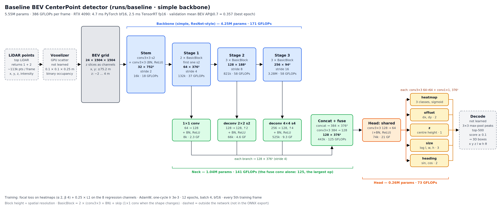

# Detector

A single-frame LiDAR 3D detector: top-LiDAR points → binary occupancy voxels → a 2D CNN over the
bird's-eye view (BEV) → a CenterPoint head. Each component has its own doc in this folder (see
[Components](#components)).

Related docs: [dataset.md](../dataset.md) (the data) and
[analytics-viewer-architecture.md](../analytics-viewer-architecture.md) (the analytics page and viewer,
including the shared `waymo_lidar.data` layer this detector reads from).

## Quick start

The examples assume the data is at `~/dev/data/waymo_v2` (with `training/` and `validation/` inside) and
the default config `configs/bev_centerpoint.yaml`. Everything a run writes goes to `runs/<name>/`.

### 1. Train

```bash
# Smoke test first (~3 min): overfit one training segment. Mean BEV AP@0.7 should climb past ~0.9.
uv run wl train ~/dev/data/waymo_v2 --name smoke --overfit 10023947602400723454_1120_000_1140_000 \
    --max-minutes 3 --set train.epochs=1000 train.eval_every=5 train.lr_schedule=constant

# Full training (12 epochs, ~15 min per epoch on the RTX 4090 box, limited by data loading)
uv run wl train ~/dev/data/waymo_v2 --name baseline

# Continue an interrupted or --max-minutes run from checkpoints/last.pt
uv run wl train ~/dev/data/waymo_v2 --name baseline --resume

# Overrides use dotted keys, e.g. another backbone or a time cap
uv run wl train ~/dev/data/waymo_v2 --name r18 --set model.backbone=resnet18 --max-minutes 60
```

- `--max-minutes` stops cleanly: it validates, saves `last.pt`, and exits. Continue later with `--resume`.
- Each run gets `checkpoints/last.pt` (every epoch), `checkpoints/best.pt` (best `train.best_metric`,
  default mean BEV AP@0.7), `eval_<epoch>.md` metric tables, the resolved `config.yaml`, and `tb/`.
- **Memory:** each DataLoader worker uses ~2.3 GiB of RAM, so the default `data.num_workers: 12` needs
  ~26–30 GiB. On a smaller machine lower it, e.g. `--set data.num_workers=6`.
- Validation runs over the full validation split every `train.eval_every` epochs. For quicker checks,
  `--set train.val_max_frames=400`.

Details: [training.md](training.md).

### 2. Monitor with TensorBoard

```bash
uv run tensorboard --logdir runs        # then open http://localhost:6006
```

Start it in a second terminal, before or during training. It picks up new runs and new data as they're
written, and shows every run under `runs/` side by side. From another machine, use
`ssh -L 6006:localhost:6006 <host>`, or add `--bind_all` to serve on the network.

What to watch:

| Tab / tag | Look for |
|---|---|
| Scalars `loss/total`, `loss/heatmap`, `loss/reg` | Falling. `train/skipped_steps` should stay 0. |
| Scalars `eval/bev_ap@0.7/mean` (and per class) | Rising at each validation. |
| Scalars `train/frames_per_s`, `train/data_wait_frac` | Throughput, and how much of it the GPU spends waiting for data (~25% at 12 workers today). |
| Scalars `train/lr`, `train/grad_norm`, `train/gpu_mem_gib` | Schedule shape, stability, memory. |
| Images `val/heatmap/<class>` | GT heatmap \| predicted heatmap, first validation frame. |
| Text `eval/table`, `config` | Full metric table per validation; the run's resolved config. |

### 3. Visualise predictions in Rerun

```bash
# Desktop viewer on one validation segment (all ~198 frames, ~20 s to compute)
uv run wl predict ~/dev/data/waymo_v2 --ckpt runs/baseline/checkpoints/best.pt \
    --segment 10203656353524179475_7625_000_7645_000

# Also show heatmaps and scores; or write an .rrd to open later / elsewhere
uv run wl predict ~/dev/data/waymo_v2 --ckpt runs/baseline/checkpoints/best.pt --segment <name> --heatmaps --labels
uv run wl predict ~/dev/data/waymo_v2 --ckpt runs/baseline/checkpoints/best.pt --segment <name> --save pred.rrd
uv run rerun pred.rrd

# Browser viewer instead of a desktop window (e.g. on a remote box: forward port 9090)
uv run wl predict ~/dev/data/waymo_v2 --ckpt runs/baseline/checkpoints/best.pt --segment <name> --web
```

Segment names are the file names (without `.parquet`) in `validation/lidar_box/`. With no `--segment`,
the first complete validation segment is used. In the viewer, predictions are **green** (true positive),
**red** (false positive) or grey (on an ignored box). Ground truth is in its **class colour** (found),
**yellow** (missed) or dim grey (ignored). Colouring uses `--min-score` (0.3) and BEV `--iou` (0.5). For the
numbers over a whole split instead: `uv run wl eval ~/dev/data/waymo_v2 --ckpt <ckpt>`.

Details: [predict.md](predict.md).

### 4. Export for deployment (ONNX / TensorRT)

```bash
uv run wl export runs/baseline/checkpoints/best.pt                                   # fp16 ONNX + .json metadata
uv run --with tensorrt-cu13 wl export runs/baseline/checkpoints/best.pt --engine     # + TensorRT engine, checked
```

This exports the network only; voxelize and decode stay in Python. On the RTX 4090 the fp16 TensorRT
engine takes 2.5 ms per frame, against 4.7 ms for PyTorch bf16. To build it on a Jetson Orin, copy the
`.onnx` and `.onnx.data` there and use `trtexec --stronglyTyped`. Details: [export.md](export.md).

## Design



The baseline model, block by block, with shapes, parameters and GFLOPs: see [model.md](model.md#architecture).

| Choice | Value | Why |
|---|---|---|
| Frame | Vehicle frame at the frame timestamp, for points and boxes: x forward, y left, z up, origin on the ground and most likely below the rear axle ([definition](../dataset.md#coordinate-frames)). The top LiDAR sits at (+1.43, 0, +2.18) m. | Boxes are labelled in this frame, and points are moved into it with rolling-shutter correction, so the two line up with no further transform. |
| Input | top LiDAR, single frame, returns 1 + 2 | The 75 m sensor covers the grid. |
| Grid | x, y ∈ [−75.2, 75.2) m at 0.1 m → 1504 × 1504; z ∈ [−2, 4) m at 0.25 m → 24 slices | Covers the top LiDAR's range and the height of trucks, with margin for hills. The grid is centred on the vehicle origin, not the sensor: along x it spans −76.6 … +73.8 m from the top LiDAR, and z ∈ [−2, 4) is 2 m below to 4 m above the ground under the car. |
| Input tensor | (24, 1504, 1504): binary occupancy, z slices as image channels; optionally + 2 BEV channels (log1p point count, max intensity) | Ordinary 2D convolutions work on it (as in PIXOR). The extras add the density and reflectance that binary occupancy drops. |
| Backbone | selectable: `simple` (2D residual CNN: stem stride 2, stages at strides 4 / 8 / 16) or torchvision `resnet18` / `resnet34` / `resnet50`; a shared neck merges every level back to stride 4 | Downsampling early keeps memory manageable at 1504². The standard ResNets are there to compare against. |
| Head | CenterPoint at stride 4 (376 × 376, 0.4 m cells): per-class heatmap + offset, z, log size, sin/cos heading | Anchor-free and simple to decode. A 0.4 m cell is fine enough for pedestrians. |
| Classes | vehicle, pedestrian, cyclist | The three classes Waymo ranks. |
| Metrics | BEV AP and 3D AP at IoU 0.5 / 0.7 / 0.8, and centre-distance AP at 0.5 / 1.0 m, per class and distance bin | Chosen for this project. Ground-truth boxes with 0 top-LiDAR points don't count. |

## Components

| Component | Code | Doc | Status |
|---|---|---|---|
| Config | `det/config.py`, `configs/bev_centerpoint.yaml` | [config.md](config.md) | **done** |
| Data stream | `det/data.py` | [data.md](data.md) | **done** |
| Voxelizer + voxel viewer | `det/voxelize.py`, `det/viz_voxels.py` | [voxelize.md](voxelize.md) | **done** |
| Targets | `det/targets.py` | [targets.md](targets.md) | **done** |
| Model | `det/model.py` | [model.md](model.md) | **done** |
| Loss | `det/loss.py` | [loss.md](loss.md) | **done** |
| Decode | `det/decode.py` | [decode.md](decode.md) | **done** |
| IoU + NMS | `det/iou.py` | [iou.md](iou.md) | **done** |
| Evaluation | `det/eval.py` | [eval.md](eval.md) | **done** |
| Training | `det/train.py` | [training.md](training.md) | **done** |
| Prediction viewer | `det/predict.py` | [predict.md](predict.md) | **done** |
| Export (ONNX / TensorRT) | `det/export.py` | [export.md](export.md) | **done** |
