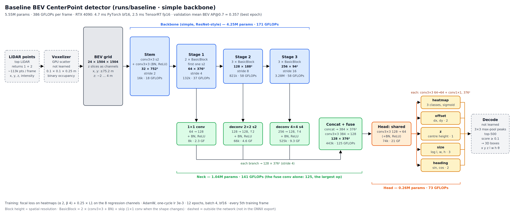

# Detector model

Part of the [Phase 2 detector](README.md). Code: `src/waymo_lidar/det/model.py`; tests:
`tests/test_det_model.py`; settings: the `model` section of the [config](config.md).

The model maps the [voxelizer's](voxelize.md) BEV occupancy image to CenterPoint outputs at the
target stride. It's three parts: a **backbone**, which is selectable; a **neck**, which brings every
backbone level to the output stride and merges them; and a **CenterPoint head**. The outputs line up
one-to-one with the [targets](targets.md).

## Usage

```python
from waymo_lidar.det.model import BEVDetector

model = BEVDetector.from_config(cfg).cuda().to(memory_format=torch.channels_last)
with torch.autocast("cuda", dtype=torch.bfloat16):
    out = model(bev.contiguous(memory_format=torch.channels_last))   # bev: (B, 24 or 26, 1504, 1504)
out["heatmap"]   # (B, 3, 376, 376)  class logits, NOT probabilities
out["reg"]       # (B, 8, 376, 376)  [dx, dy, z, log l, log w, log h, sin, cos] = targets.REG_FIELDS
```

Benchmark: `uv run python -m waymo_lidar.det.model --backbone simple resnet18 resnet34 resnet50 --batch 1 2 4 8 [--extras]`.

## Output contract

- **`heatmap`** holds logits. The loss applies a sigmoid inside the focal loss, and decode applies
  one before picking peaks. Channel *c* is `data.classes[c]`.
- **`reg`** channels are in `REG_FIELDS` order, so the loss gathers `reg[:, :, ind]` at the targets'
  `target_ind` and compares it directly with `target_reg`. `reg_to_boxes` turns either one into boxes.
- **Spatial layout** matches the targets: row = y, column = x, at `target.out_stride` (default 4,
  0.4 m cells).

## Architecture



The baseline (`runs/baseline`: `simple` backbone, default config), with shapes, parameters and GFLOPs
measured from the checkpoint ([SVG](img/baseline_architecture.svg)). The neck's 3×3 fuse conv (384 → 128
channels at 376²) is the single most expensive op: 125 of the model's 386 GFLOPs. It's the first thing to
slim down if latency matters, e.g. on a Jetson Orin (see [export.md](export.md)).

```
BEV (B, C_in, 1504, 1504)
  │
  ├─ backbone ──► feature maps at strides s₁ < s₂ < … (see below)
  │
  ├─ neck: per level, bring to the output stride (4), each to 128 channels
  │      stride > 4: k×k transposed conv, k = stride / 4      stride = 4: 1×1 conv
  │      → BN → ReLU, concatenate, then conv3×3 → BN → ReLU                    (128, 376²)
  │
  └─ head: shared conv3×3 → BN → ReLU                                          (64, 376²)
         heatmap: conv3×3 → BN → ReLU → conv1×1 → 3 logits   (bias −2.19)
         offset 2 · z 1 · size 3 · rot 2: each conv3×3 → BN → ReLU → conv1×1
         → reg = concat in REG_FIELDS order                                    (8, 376²)
```

### Backbones (`model.backbone`)

**`simple`** (default): this project's small residual CNN.

| Part | Ops | Output (full size) | Params |
|---|---|---|---|
| stem | conv3×3 s2 → BN → ReLU → conv3×3 → BN → ReLU | 32 × 752² (stride 2) | |
| stage 1 | 2 BasicBlocks, first with stride 2 | 64 × 376² (stride 4) | |
| stage 2 | 3 BasicBlocks, first with stride 2 | 128 × 188² (stride 8) | |
| stage 3 | 3 BasicBlocks, first with stride 2 | 256 × 94² (stride 16) | |
| **backbone total** | | | 4.25M |
| neck | 3 branches → 384 → 128 | 128 × 376² | 1.04M |
| head | shared + 5 branches | 3 + 8 × 376² | 0.26M |
| **model total** | | | **5.55M** |

A BasicBlock is two conv3×3 + BN with a residual shortcut, using a 1×1 projection when the stride or
width changes. These are the same blocks as in ResNet and PIXOR.

**`resnet18` / `resnet34` / `resnet50`:** torchvision's ResNet, without avgpool and fc.

- **Input:** `conv1` (7×7, stride 2) is rebuilt for the 24 or 26 input channels. The stride-2 maxpool
  is kept, so the layers sit at their standard strides.
- **Neck input:** the layers in `model.resnet.layers` (default all four) feed the neck.

| Layer | Stride | Grid | Channels (18 / 34) | Channels (50) |
|---|---|---|---|---|
| `layer1` | 4 | 376² | 64 | 256 |
| `layer2` | 8 | 188² | 128 | 512 |
| `layer3` | 16 | 94² | 256 | 1024 |
| `layer4` | 32 | 47² | 512 | 2048 |

| Backbone | Backbone params | Neck params | Model total |
|---|---|---|---|
| simple | 4.25M | 1.04M | 5.55M |
| resnet18 | 11.24M | 5.38M | 16.89M |
| resnet34 | 21.35M | 5.38M | 26.99M |
| resnet50 | 23.57M | **19.76M** | 43.59M |

resnet50's neck is large because `layer4`'s 2048 channels go through an 8×8 transposed conv
(2048 × 128 × 64 ≈ 16.8M weights). If resnet50 is used seriously, add a 1×1 channel reduction before
upsampling.

**`resnet.pretrained: true`** loads ImageNet weights. The new `conv1` is initialised from the RGB
kernels' mean, replicated across the input channels and scaled by 3 / C_in. The rest of the network
keeps the ImageNet weights, and the model's own init doesn't overwrite them. This is an experiment:
ImageNet features were learned on photos, not occupancy grids.

### Receptive field

Theoretical, along the deepest path and including the neck and head convs:

| Backbone | At the deepest level | Final output |
|---|---|---|
| simple | 299 voxels (29.9 m) at stride 16 | ~32 m |
| resnet18 | 435 voxels (43.5 m) at stride 32 | ~46 m |
| resnet34 | 899 voxels (89.9 m) | ~92 m |
| resnet50 | 427 voxels (42.7 m) | ~45 m |

The *effective* receptive field is much smaller than the theoretical one. Even so, `simple` covers a
long truck (~15–20 m) plus its surroundings.

## Initialisation

- **Convs and transposed convs:** Kaiming-normal (fan-out, ReLU).
- **BatchNorm:** weight 1, bias 0.
- **Head output convs** (the final 1×1 of every branch): weights N(0, 0.01), as in
  RetinaNet / CenterNet. The heatmap bias is `heatmap_bias` = −2.19 and the regression biases are 0.

The small output weights matter. With Kaiming init on the heatmap's 3-channel output conv, the random
logits swamped the bias: the measured mean initial probability was 0.42 instead of ~0.1, which would
make the focal loss start with huge false-positive gradients. Now every backbone starts at mean
sigmoid 0.09–0.12.

## Performance

Full size (24 × 1504 × 1504), real voxelized frames, RTX 4090, bf16 autocast, channels_last. The
training step is forward + backward with a dummy loss; peak memory is allocated memory.

| Backbone | Batch | Forward | Train step | Peak memory |
|---|---|---|---|---|
| simple | 1 | 4.9 ms | 16.8 ms | 2.0 GiB |
| simple | 4 | 22.4 ms | 74.0 ms | 5.5 GiB |
| simple | 8 | 46.4 ms | 152.3 ms | 10.2 GiB |
| resnet18 | 4 | 26.0 ms | 81.5 ms | 6.1 GiB |
| resnet18 | 8 | 53.9 ms | 166.0 ms | 11.3 GiB |
| resnet34 | 4 | 32.3 ms | 101.4 ms | 7.1 GiB |
| resnet34 | 8 | 66.2 ms | 206.3 ms | 13.1 GiB |
| resnet50 | 4 | 54.3 ms | 171.8 ms | 11.7 GiB |
| resnet50 | 8 | — | — | out of memory |

- **Batch size stays at 4** (`train.batch_size`). Batch 8 gives no speedup per frame (~19 ms per frame
  for `simple` either way), and 4 fits every backbone, including resnet50. Optimizer state and
  targets add little on top: AdamW is 2 × params × 4 B, 44 MB for `simple`.
- **Epoch time estimate** at 31.6k frames per epoch (`frame_interval_train` 5), from these step times:
  ~10 min for `simple`, ~11 min for resnet18, ~13 min for resnet34 and ~23 min for resnet50. The
  [data stream](data.md#performance) delivers ~125 frames/s, ahead of the ~54 frames/s `simple`
  trains at.

## Tests

`uv run pytest tests/test_det_model.py` (25 tests, ~7 s). Most use a 256 × 256 grid (±12.8 m) for
speed:

- **Shapes:** for every backbone, with 24 or 26 input channels, heatmap (B, 3, 64, 64) and
  reg (B, 8, 64, 64), finite. Also `out_stride` 8.
- **ResNet wiring:** for layers [1, 2, 3], [1, 2, 3, 4] and [2, 4], `conv1` takes 24 channels, and
  the reported channels and strides match the actual feature maps. Parameter counts match
  torchvision exactly (minus fc, with `conv1` rebuilt).
- **Pretrained:** the adapted `conv1` equals mean(RGB) × 3 / C_in, and the rest of the network is
  untouched by the model init. Skipped if the weights can't be downloaded.
- **Init:** mean initial sigmoid(heatmap) is in (0.05, 0.2). The same seed gives identical weights.
- **Gradients:** every parameter gets a finite, non-zero gradient.
- **Config wiring:** wider, deeper or narrower settings change the parameter count; the reg head has
  `len(REG_FIELDS)` outputs.
- **Full size:** a real frame on the GPU in bf16 gives (1, 3, 376, 376) and (1, 8, 376, 376).
